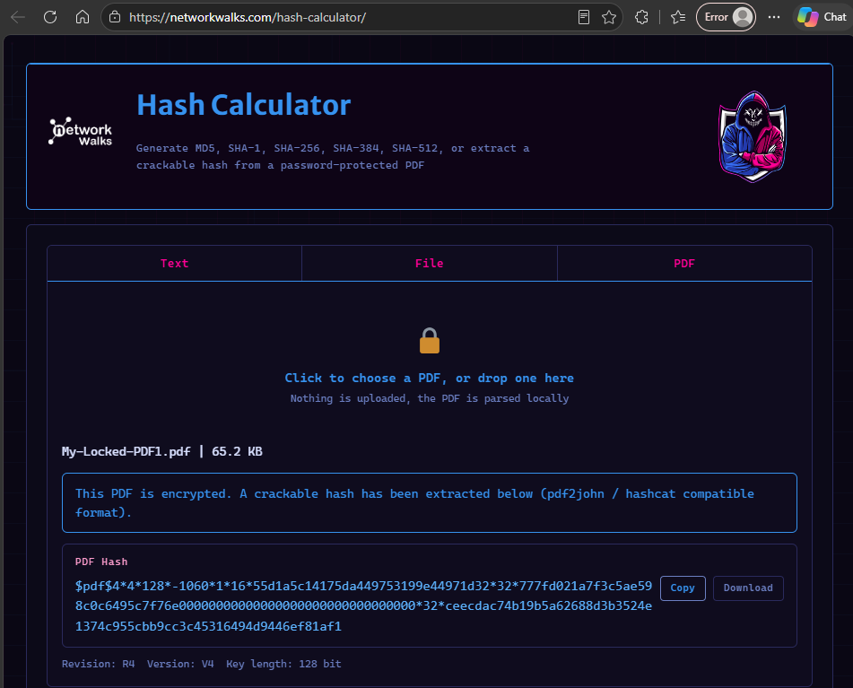
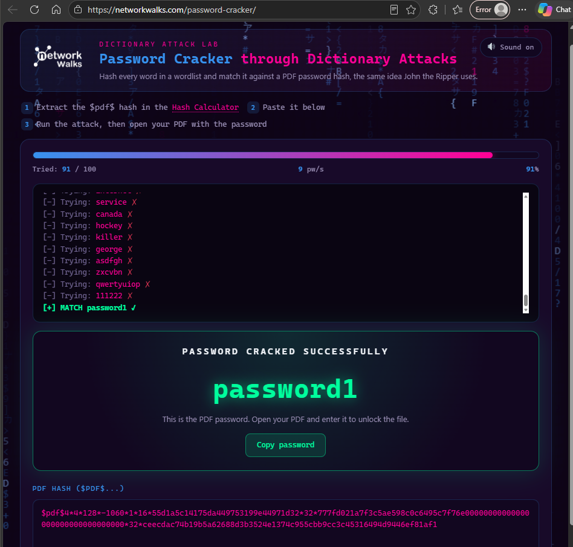
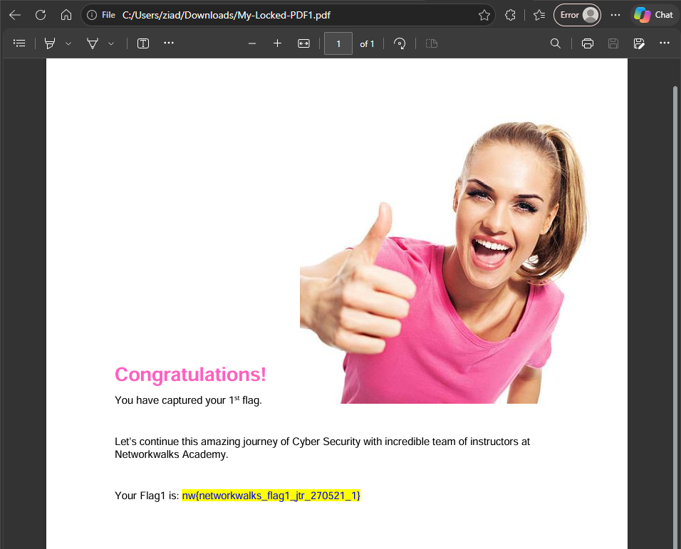
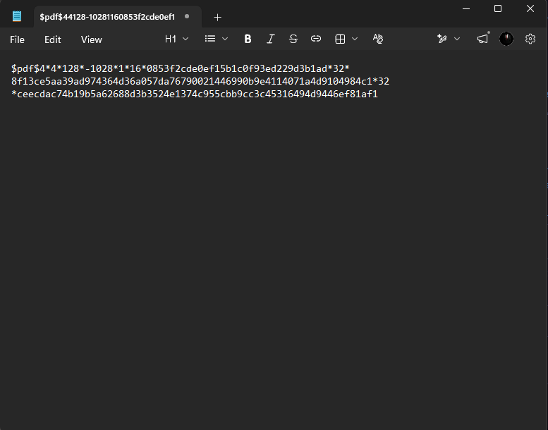
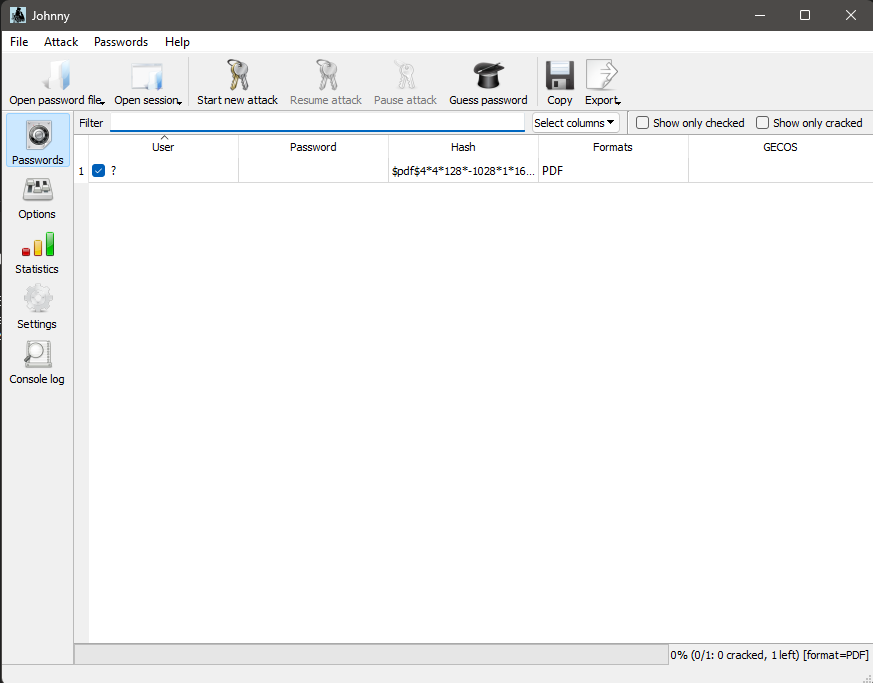
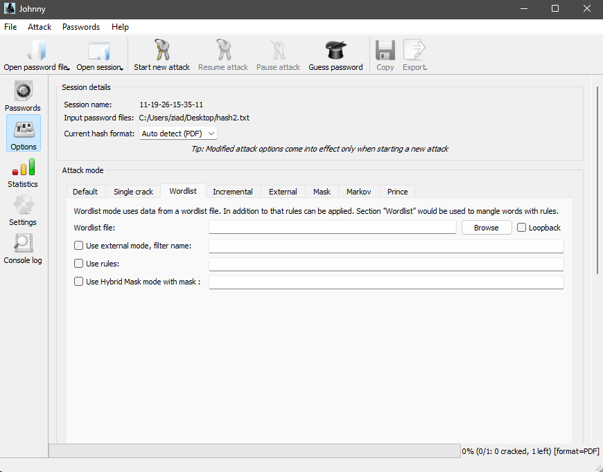
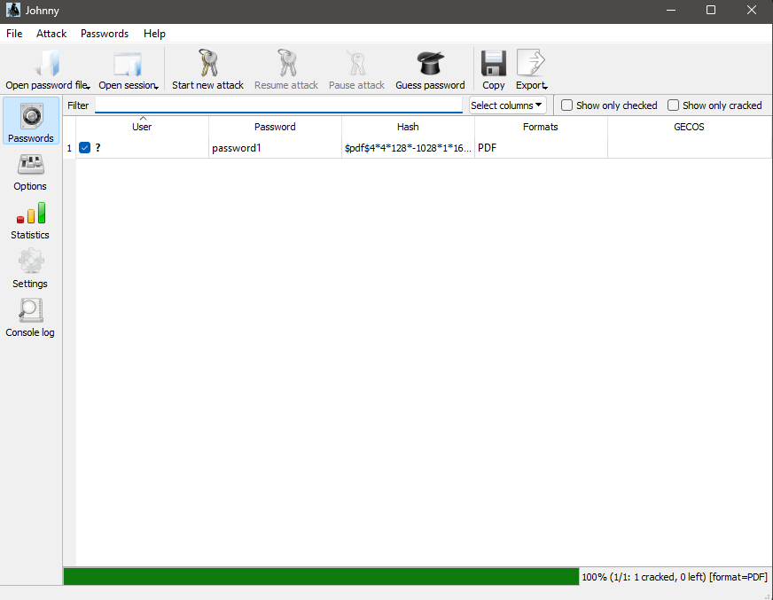
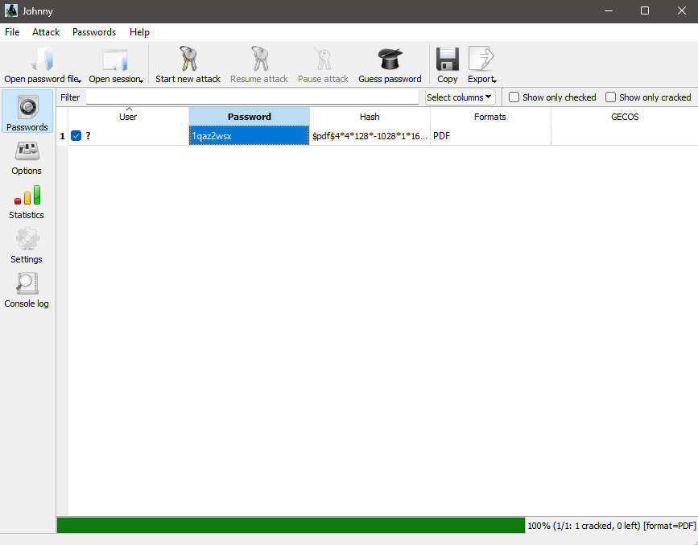
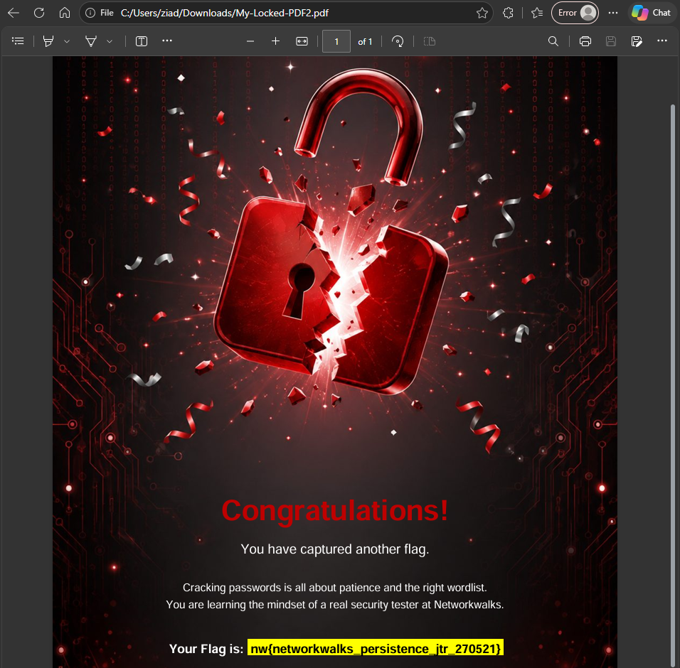
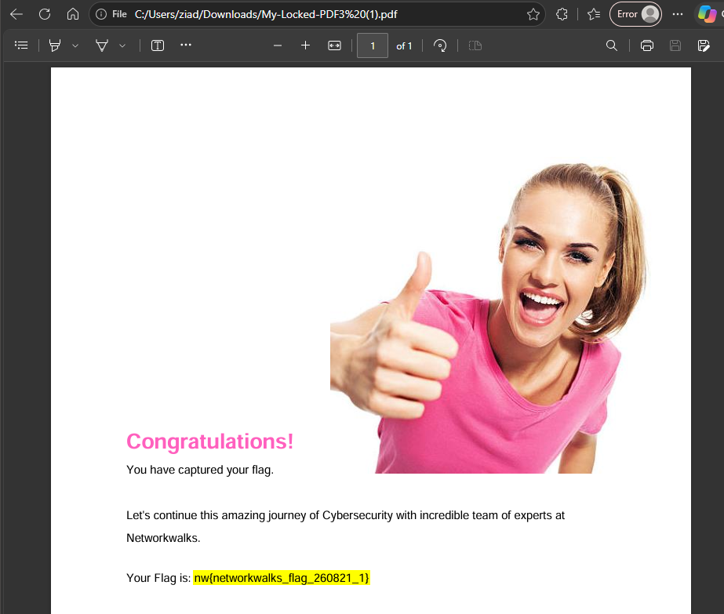

# 🔓 Networkwalks Week 3: Password Cracking

## 📖 Overview
This repository contains my documentation, evidence, and findings for Week 3 of the Networkwalks Cybersecurity Internship (Batch B084). 

The objective of this project was to understand the mechanics of password hashing and cracking by recovering passwords from three encrypted PDF files. I performed this lab using two distinct methodologies: the browser-based **Networkwalks Hash Calculator & Password Cracker** for the first target, and the industry-standard **John the Ripper** CLI/GUI tool (using the Johnny interface) paired with the `rockyou.txt` wordlist for the subsequent targets.

## 🛠️ Tools Used
| Tool | Category | Purpose |
| :--- | :--- | :--- |
| **Networkwalks Hash Calculator** | Hash Extraction | browser-based extraction of `$pdf$` hashes from encrypted PDFs. |
| **Networkwalks Password Cracker** | Password Cracking | Web-based dictionary attack tool used to crack the first PDF. |
| **John the Ripper / Johnny** | Password Cracking | Offline dictionary attack against hashes wordlist. |
| **Notepad** | Utility | Saving extracted hashes into `.txt` format for JTR ingestion. |

---

## 📂 Methodology & Execution

### Part 1: Networkwalks Web Tools (PDF 1)
I started by using the custom Networkwalks browser-based tools to establish a baseline.
1.  **Hash Extraction:** Uploaded `My-Locked-PDF1.pdf` to the Hash Calculator. The tool parsed the file locally and outputted the John/Hashcat compatible `$pdf$` hash.
2.  **Cracking Process:** Pasted the hash into the Networkwalks Password Cracker. The tool ran a dictionary attack, displaying the real-time attempts against its internal wordlist.
3.  **Result:** Successfully recovered the password (`password1`) for PDF 1.

### Part 2: John the Ripper / Johnny (PDFs 2 & 3)
To simulate a more realistic penetration testing environment, I switched to John the Ripper on my Windows machine.
1.  **Hash Extraction:** Extracted the hashes from the remaining PDFs and saved them locally as text files (e.g., `hash.txt`).
2.  **Cracking Process:** Loaded the hashes into the Johnny GUI. I configured the attack mode to use a **Wordlist** attack, specifically pointing the tool to the famous `rockyou.txt` wordlist.
3.  **Result:** Johnny successfully cracked both PDF 2 (which surprisingly shared the same weak password as PDF 1) and PDF 3, revealing its distinct password.

---

## 🚩 Captured Flags & Credentials

| Target File | Tool Used | Recovered Password | Captured Flag |
| :--- | :--- | :--- | :--- |
| **My-Locked-PDF1.pdf** | NW Web Tools | `password1` | `nw{networkwalks_flag_260821_1}` |
| **My-Locked-PDF2.pdf** | Johnny (rockyou) | `password1` | `nw{networkwalks_persistence_jtr_270521}` |
| **My-Locked-PDF3.pdf** | Johnny (rockyou) | `1qa2zwsx` | `nw{networkwalks_flag_jtr_270521_1}` |

---

## 🖼️ Evidence Gallery

### Part 1: Networkwalks Web Tools (PDF 1)
*   **Extracting the `$pdf$` Hash:**
    
*   **Successful Dictionary Attack:**
    
*   **PDF 1 Unlocked (Flag Captured):**
    

### Part 2: John the Ripper / Johnny (PDFs 2 & 3)
*   **Saving Extracted Hash to `.txt`:**
    
*   **Loading Hash into Johnny:**
    
*   **Configuring Wordlist Attack:**
    
*   **PDF 2 Password Cracked (`password1`):**
    
*   **PDF 3 Password Cracked (`1qa2zwsx`):**
    
*   **PDF 2 Unlocked (Flag Captured):**
    
*   **PDF 3 Unlocked (Flag Captured):**
    

---
*Completed as part of the Networkwalks Cybersecurity Internship (Batch B084). Special thanks to Sir Waqas Karim (CCIE) and the NETWORKWALKS team.*
